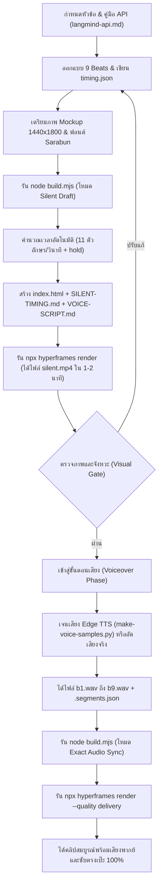

# LangMind Video Producer — EP04-EP11 Production Standard

คู่มือและแม่แบบระบบผลิตวิดีโออธิบาย LangMind API คุณภาพระดับ Master (1080×1920 30fps H.264) ถอดแบบพิมพ์เขียวจากความสำเร็จของ **EP04 v3 และ EP06–EP11** 

สกิลนี้เปลี่ยนกระบวนการทำวิดีโอให้เป็นระบบอัตโนมัติ (Automated Build & Fast Prototyping) ช่วยให้การสร้างตอนใหม่ (เช่น EP03, EP05, EP12+) หรือการปรับปรุงตอนเดิม ได้ผลลัพธ์ที่ **แม่นยำ สวยงาม จังหวะลงตัว และมีเอกลักษณ์เดียวกันแบบ 100%**

---

## 1. เอกลักษณ์และระบบภาพ (Visual Design System)

วิดีโอทุกตอนในซีรีส์นี้ใช้ธีม **"Editorial Paper & Sage Ink"** ซึ่งผสมผสานความน่าเชื่อถือแบบนิตยสารเทคโนโลยีเข้ากับความสบายตา ไม่ใช้พื้นหลังมืด Cyberpunk หรือแสงนีออนแสบตา

* **ขนาดและอัตราเฟรม**: `1080 × 1920` (9:16 แนวตั้งสำหรับสมาร์ตโฟน), `30 fps`, สี H.264 High Profile
* **โทนสีหลัก (Color Palette)**:
  * พื้นหลังกระดาษอุ่น (Paper White): `#fcfbf7` (ฐาน), `#f6f4ee` (การ์ด), `#ede8df` (เส้นขอบ)
  * ตัวอักษรหมึกเข้ม (Ink Black): `#2c2825` (หัวข้อ), `#524c46` (คำบรรยาย/คำอ่าน)
  * แถบ Minimap และสีประจำ 3 การเชื่อมต่อ:
    * **ครั้งที่ 1 (เตรียม/ส่งข้อมูล)**: สีเขียว Forest Green (`#38815A`)
    * **ครั้งที่ 2 (ประมวลผล/ผูกระบบ)**: สีทองมัสตาร์ด Ochre Gold (`#8d732c` หรือ `#9c6500`)
    * **ครั้งที่ 3 (ทดสอบ/ดึงผลลัพธ์)**: สีเขียวน้ำทะเล Deep Teal (`#1E7578`)
* **Typography**:
  * ใช้ Google Font **Sarabun** (Regular 400 & Bold 700) บรรจุไฟล์ฟอนต์ในโฟลเดอร์ `assets/fonts/` ประจำตอนโดยตรง ห้ามเรียกโหลดผ่าน Google Fonts CDN เพื่อความเสถียร 100% ขณะ Render แบบ Offline
  * จัดตำแหน่งซับไตเติลให้อ่านง่าย กึ่งกลางกรอบ มีฉากหลังโปร่งแสงตัดขอบมน
* **ตัวละครและแบรนด์ (Shared Assets)**:
  * ใช้ **Robot (Shared Mascot)** จาก `shared/assets/characters/robot/` เลือกท่าทางให้สอดคล้องกับเนื้อหา เช่น `01-question.png` (สงสัย), `04-open-arms.png` (ต้อนรับ), `10-thumbs-up.png` (สำเร็จ), `11-reading.png` (อ่านคู่มือ), `21-carry-books.png` (จัดเอกสาร)
  * โลโก้แบรนด์จาก `shared/assets/brand/langmind-logo.png`
* **Mockup หน้าจออุปกรณ์ (Device Mockup System)**:
  * ใช้ภาพจำลองความละเอียด `1440 × 1800` px ใส่ในกรอบมือถือมน (`.device`)
  * มี 2 เลเยอร์ซ้อนกัน (`img` และ `img-a`) เพื่อทำ Animation เปลี่ยนสถานะ Before/After (เช่น หน้าต่างก่อนอัปโหลด -> แสดงผลลัพธ์ที่ค้นเจอ) ด้วยการ Fade Opacity

---

## 2. โครงเรื่อง 9 ช่วง (The 9-Beat Narrative Blueprint)

โครงสร้างการเล่าเรื่องของทุกตอนจะยึดคำถามของผู้ชมเป็นแกนหลัก แบ่งเป็น 9 Beats ชัดเจน:

| Beat | ชื่อช่วง | คำถามของผู้ชม / หน้าที่ | องค์ประกอบภาพและอนิเมชัน |
|---|---|---|---|
| **b1** | **ปัญหา & ตั้งคำถาม** | "ฟีเจอร์นี้ช่วยแก้ปัญหาอะไรในชีวิตจริง?" | จอมือถือแสดงปัญหาจริง + ตัวละคร Robot สงสัย + Tip box สรุปประโยชน์ + ป้ายชิป 3 คำถามลอยขึ้นมา (`เตรียมอะไร?`, `เชื่อมตรงไหน?`, `ใช้ผลยังไง?`) |
| **b2** | **ภาพรวมสถาปัตยกรรม** | "ภาพรวมระบบและการไหลของข้อมูลเป็นยังไง?" | ไดอะแกรม 3 ส่วน (แอป/หลังบ้าน ⇄ LangMind API ⇄ บริการปลายทาง) + ลูกศรรับส่งข้อมูลพร้อม Dot เคลื่อนไหว + ป้ายลำดับ 3 ขั้นตอน (`1 อัปโหลด`, `2 ผูกระบบ`, `3 ทดสอบ`) |
| **b3** | **1. สิ่งที่ต้องเตรียม** | "ก่อนเขียนโค้ดต้องมีอะไรบ้าง?" | การ์ด 3 ใบซ้อนกันอย่างเรียบร้อย: 1. Agent & Config ในเว็บ (พร้อมกล่องเตือน Error หากไม่ตั้งค่า เช่น 403 หรือ 503), 2. API Key (`lmpat_`) พร้อมชิประบุ Scopes ที่ต้องใช้, 3. ระบบหลังบ้าน (ย้ำเตือนเก็บ Key ฝั่ง Server) |
| **b4** | **2. เชื่อมครั้งที่ 1** | "เริ่มต้นส่งข้อมูลหรือเปิดใช้งานอย่างไร?" | แถบ Minimap ครั้งที่ 1 (สีเขียว) + ช่อง Input Data (`.slot-in`) + กล่องโค้ด HTTP Request (Method, Endpoint, Headers, Scopes) + กล่องคำตอบ Response (`.slot-out`) หรือการ Poll สถานะ (`pending -> indexed`) |
| **b5** | **2. เชื่อมครั้งที่ 2** | "ประมวลผลหรือผูกคลังเข้ากับ Agent อย่างไร?" | แถบ Minimap ครั้งที่ 2 (สีทอง) + กล่องโค้ดและพารามิเตอร์สำคัญ (เช่น `dataset_id`, `input_mode: voice`, `weight`) + การตอบรับจากระบบ |
| **b6** | **2. เชื่อมครั้งที่ 3** | "ทดสอบยิงหรือดึงผลลัพธ์จริงอย่างไร?" | แถบ Minimap ครั้งที่ 3 (สีเขียวน้ำทะเล) + โค้ดทดสอบ (เช่น `/retrieval/test`, `/voice/speech`) + กล่องผลลัพธ์ (`segments`, `score`, เสียงตอบกลับ) + หน้าจอมือถือ `.img-a` คลี่ผลลัพธ์จำลอง |
| **b7** | **3. นำผลไปใช้ & ข้อควรระวัง** | "ได้ผลกลับมาแล้วนำไปทำอะไรต่อได้บ้าง และมีข้อจำกัดอะไร?" | ไอคอน 3-4 ประเด็น: การนำข้อมูลไปต่อในแอป, ทางเลือกการส่งข้อมูล (batch, url, text), และข้อควรระวังสำคัญ (เช่น `score` คือค่าความคล้ายไม่ใช่เปอร์เซ็นต์, ขนาดไฟล์สูงสุด, การจัดการข้อความว่าง) |
| **b8** | **สรุปเนื้อหา** | "สรุปทั้งตอนใน 3 ประโยคสั้น ๆ" | การ์ดสรุป 3 เสาหลัก: 1. เตรียม (Agent + Key + Server) → 2. เชื่อม (3 ขั้นตอน) → 3. ใช้ผล (อัปเดตระบบอัตโนมัติ) |
| **b9** | **ผู้สนับสนุน & CTA** | "คลิปนี้สนับสนุนโดยใคร และเริ่มใช้งานได้ที่ไหน?" | โลโก้ LangMind ขยายเด่นตรงกลาง + ข้อความ "คลิปนี้สนับสนุนโดย LangMind" + เว็บไซต์ `langmind.in.th` |

---

## 3. สถาปัตยกรรมการผลิต 2 ระดับ (Two-Stage Engine)

เพื่อตัดปัญหาการรอเสียงพากย์ และลดเวลาการลองผิดลองถูก EP04-EP11 ใช้ระบบ **Dual-Track Workflow**:



### Stage 1: Silent Draft Mode (ตรวจภาพและจังหวะอ่านรวดเร็ว)
* กำหนดข้อความเสียงพูด (`say`) และข้อความซับไตเติล (`cap`) ใน `timing.json`
* สคริปต์ `build.mjs` จะคำนวณเวลาแต่ละประโยคอัตโนมัติตามอัตราอ่านมาตรฐานภาษาไทย:  
  $$\text{duration} = \frac{\text{len}(say)}{\text{chars\_per\_second}} + 0.35\text{s} + \text{hold}$$
  *(โดย `chars_per_second` ตั้งต้นที่ 11 ตัวอักษร/วินาที และช่องไฟระหว่างประโยค 0.35 วินาที)*
* สามารถ Render วิดีโอภาพชัด 1080×1920 ออกมาตรวจความสวยงาม การตัดบรรทัดซับ และความต่อเนื่องได้ทันทีโดยไม่ต้องรอไฟล์เสียง

### Stage 2: Voiceover & Final Multiplexing Mode (เสียงจริงและซับตรง 100%)
* เมื่อต้องการใส่เสียง สามารถใช้สคริปต์ `make-voice-samples.py` เจนเสียง Edge TTS (ฟรี ไม่ใช้ API Key) เสียง `th-TH-NiwatNeural` หรือ `th-TH-PremwadeeNeural` ปรับสปีด `-16%` พร้อมตัด Silence หัวท้ายอัตโนมัติ
* สคริปต์จะสร้างไฟล์เสียง `assets/voice/<beat>.wav` และตาราง Marker เวลา `assets/voice/<beat>.segments.json`
* เมื่อรัน `node build.mjs` ซ้ำ ระบบจะตรวจจับไฟล์เสียงและมาร์กเกอร์โดยอัตโนมัติ สลับจากการประเมินตัวอักษรมาใช้ **ความยาวไฟล์เสียงจริงและจังหวะคำพูดจริง** ทันที ซับไตเติลจะขยับตรงกับเสียงพากย์ระดับเฟรม

---

## 4. โครงสร้างโฟลเดอร์มาตรฐานประจำตอน (Episode Folder Structure)

ทุก Episode ที่สร้างใหม่ ต้องมีโครงสร้างโฟลเดอร์ดังนี้:

```text
episodes/epXX-<slug>/
├── README.md                      # สถานะภาพรวม วิดีโอที่ Render ล่าสุด ลำดับถัดไป
├── PLAN.md                        # แผนงาน W3: โจทย์คนดู โครง 9 Beat และ Claim Ledger
├── SCRIPT.md                      # บทพากย์ภาษาพูด 9 Beat และข้อความซับ
├── STORYBOARD.md                  # Storyboard ละเอียดและข้อกำหนดแบบหน้าจอ Mockup
├── CATALOG.md                     # ทะเบียนชิ้นส่วน Motion และจุดตรวจ W5
└── video/                         # รูตของโปรเจกต์ HyperFrames
    ├── assets/
    │   ├── fonts/
    │   │   ├── Sarabun-Regular.ttf
    │   │   └── Sarabun-Bold.ttf
    │   ├── gsap.min.js            # GSAP 3.x Standalone
    │   ├── langmind-logo.png      # โลโก้ LangMind
    │   ├── <robot-pose>.png       # หุ่นยนต์ Mascot ประจำตอน
    │   ├── app-<name>-1.jpg       # หน้าจอ Mockup สถานะที่ 1 (1440x1800)
    │   ├── app-<name>-2.jpg       # หน้าจอ Mockup สถานะที่ 2 (1440x1800)
    │   └── voice/                 # (ใส่เมื่อเข้าสู่ Stage 2) b1.wav ... b9.wav
    ├── build.mjs                  # คอมไพเลอร์แปลง timing.json -> index.html
    ├── timing.json                # ข้อมูลกำหนดเวลาและบทพากย์ทั้ง 9 Beat
    ├── index.html                 # หน้า HTML สำหรับ HyperFrames (สร้างจาก build.mjs)
    ├── style.css                  # สไตล์ชีท Editorial Paper & Sage Ink
    ├── motion.js                  # ระบบควบคุมคิวอนิเมชัน GSAP แบบ Seek-Safe
    ├── SILENT-TIMING.md           # ตารางเวลาอ่านสำหรับวางเสียง (สร้างจาก build.mjs)
    ├── VOICE-SCRIPT.md            # บทรวมสำหรับนักพากย์ (สร้างจาก build.mjs)
    ├── REVIEW.md                  # บันทึกผลการตรวจ Technical, Visual และ Storytelling
    └── make-voice-samples.py      # สคริปต์สร้างเสียงพากย์ Edge TTS (ทางเลือก)
```

---

## 5. วิธีสร้าง Episode ใหม่แบบ Step-by-Step

เมื่อผู้ใช้สั่งให้ทำตอนใหม่ ให้ดำเนินงานตาม 6 ขั้นตอนนี้:

### ขั้นที่ 1: เตรียมเนื้อหาและแผนงาน (W3)
1. ศึกษา Endpoint และข้อมูลทางเทคนิคจาก `langmind-api.md` (ยึดหลักฐานเป็นจริง ห้ามแต่งพารามิเตอร์)
2. สร้างโฟลเดอร์ `episodes/epXX-<slug>/`
3. คัดลอกและกรอกข้อมูลลงใน `PLAN.md`, `SCRIPT.md`, `STORYBOARD.md`, `CATALOG.md` จากโฟลเดอร์ `templates/`
4. จัดทำ **Claim Ledger** ระบุสถานะ `documented`, `observed`, `illustrative` ให้ชัดเจน

### ขั้นที่ 2: เตรียม Assets ประจำตอน
1. สร้างโฟลเดอร์ `episodes/epXX-<slug>/video/assets/`
2. คัดลอกฟอนต์ `Sarabun-Regular.ttf`, `Sarabun-Bold.ttf`, `gsap.min.js` จากตอนเดิม (เช่น EP06 หรือ EP04)
3. คัดลอก `langmind-logo.png` จาก `shared/assets/brand/`
4. คัดลอก Robot Mascot จาก `shared/assets/characters/robot/` ตามท่าที่ระบุใน Storyboard
5. จัดเตรียมภาพ Mockup 2 ภาพขนาด `1440 × 1800` px (เช่น `app-feature-1.jpg`, `app-feature-2.jpg`) ใส่ป้าย "ภาพจำลอง" ชัดเจน

### ขั้นที่ 3: จัดทำโครงสร้างโค้ดและการตั้งเวลา
1. นำไฟล์แม่แบบจากสกิลนี้ไปใส่ใน `video/`:
   * `timing.template.json` -> `timing.json` (กรอกบททั้ง 9 Beat)
   * `build.template.mjs` -> `build.mjs` (ปรับแต่ง Markup ใน `scenes` ให้ตรงกับ API ประจำตอน)
   * `style.template.css` -> `style.css`
   * `motion.template.js` -> `motion.js`
   * `make-voice-samples.template.py` -> `make-voice-samples.py`
2. บันทึกและตรวจสอบ Markup ใน `build.mjs` ให้มีครบทั้ง 9 Beat (`b1` ถึง `b9`)

### ขั้นที่ 4: คอมไพล์และตรวจความพร้อม (Build & Check)
1. เปิด Terminal ในโฟลเดอร์ `episodes/epXX-<slug>/video/`
2. รันคำสั่งคอมไพล์:
   ```powershell
   node build.mjs
   ```
   *(คำสั่งนี้จะสร้าง `index.html`, `SILENT-TIMING.md`, และ `VOICE-SCRIPT.md`)*
3. รันคำสั่งตรวจความถูกต้องของ HyperFrames:
   ```powershell
   npx hyperframes check
   ```
   *(ต้องได้ 0 finding / 0 error)*

### ขั้นที่ 5: Render ฉบับภาพตัวอย่าง (Silent Draft Render)
1. สั่ง Render วิดีโอ Silent Draft สำหรับส่งตรวจภาพ:
   ```powershell
   npx hyperframes render --out "epXX-<slug>-silent.mp4"
   ```
2. ตรวจสอบไฟล์ MP4 ที่ได้: ขนาดไฟล์, ความยาว, ความคมชัดของตัวหนังสือ, และจังหวะภาพ
3. เขียนบันทึกผลการตรวจสอบลงใน `REVIEW.md` และอัปเดต `README.md`

### ขั้นที่ 6: สร้างเสียงพากย์และ Render ฉบับสมบูรณ์ (เมื่อได้รับคำสั่งทำเสียง)
1. รันสคริปต์สร้างเสียงพากย์ Edge TTS:
   ```powershell
   python make-voice-samples.py
   ```
   *(หรือนำไฟล์เสียงที่บันทึกจริงมาใส่ใน `assets/voice/b1.wav` ถึง `b9.wav`)*
2. รัน `node build.mjs` อีกครั้งเพื่อซิงค์เวลาและคลื่นเสียง
3. สั่ง Render วิดีโอฉบับสมบูรณ์:
   ```powershell
   npx hyperframes render --quality delivery --out "epXX-<slug>-full.mp4"
   ```

---

## 6. จุดตรวจคุณภาพ (Quality Verification Gates)

ก่อนส่งมอบงาน ต้องผ่านจุดตรวจ 5 ด้านตามมาตรฐาน EP04-EP11:

1. **Technical Gate**:
   * `npx hyperframes check` ผ่าน 100% (0 errors, 0 warnings)
   * ฟอนต์ Sarabun โหลดจากโฟลเดอร์ local ไม่มีการพึ่งพาอินเทอร์เน็ต
   * วิดีโอ Decode ผ่าน ไม่มีเฟรมกระตุกหรือข้ามช่วงเวลาเมื่อลาก Seek Bar
2. **Visual & Layout Gate**:
   * สีและสไตล์ตรงตาม "Editorial Paper & Sage Ink"
   * ตัวหนังสือไทยไม่ขาดวรรค สระไม่ลอย หรือโดนตัดขอบจอ
   * ป้ายบอกขั้นตอน Minimap มีสีตรงกัน (เขียว / ทอง / เขียวน้ำทะเล)
   * ภาพ Mockup คมชัด ไม่แตก และมีป้าย "ภาพจำลอง" ชัดเจน
3. **Storytelling Gate**:
   * มีครบ 9 Beat ตามโครงเรื่องมาตรฐาน
   * แยกหน้าที่ระหว่างแอปของลูกค้าและ LangMind API ชัดเจน
   * อธิบายเหตุผลในชีวิตจริง ไม่ใช่แค่การอ่านชื่อฟังก์ชันตามเอกสาร
4. **Audio & Subtitle Gate**:
   * หากเป็นฉบับ Silent Draft: เวลาอ่านของแต่ละช่วงต้องคำนวณจากสูตร 11 chars/s + hold อย่างถูกต้อง
   * หากเป็นฉบับสมบูรณ์มีเสียง: เสียงพากย์ต้องตรงกับซับไตเติลคำต่อคำ และเว้นวรรคหายใจอย่างเป็นธรรมชาติ
5. **API & Claims Gate**:
   * ข้อมูล Endpoint, Method, Header, และ Request/Response ต้องตรงกับ `langmind-api.md`
   * ไม่มี API Key หรือ Secret จริงหลุดในวิดีโอ (ใช้ Bearer Token สมมติ เช่น `lmpat_••••••••`)
   * ปิดท้ายด้วยฉากผู้สนับสนุน LangMind พร้อม `langmind.in.th` ทุกตอน

---

## 7. แม่แบบที่พร้อมใช้งาน (Available Templates)

ดูไฟล์แม่แบบสำเร็จรูปได้ในไดเรกทอรี `templates/`:
* [timing.template.json](templates/timing.template.json)
* [build.template.mjs](templates/build.template.mjs)
* [motion.template.js](templates/motion.template.js)
* [style.template.css](templates/style.template.css)
* [make-voice-samples.template.py](templates/make-voice-samples.template.py)
* [PLAN.template.md](templates/PLAN.template.md)
* [STORYBOARD.template.md](templates/STORYBOARD.template.md)
* [SCRIPT.template.md](templates/SCRIPT.template.md)
* [CATALOG.template.md](templates/CATALOG.template.md)
* [REVIEW.template.md](templates/REVIEW.template.md)
