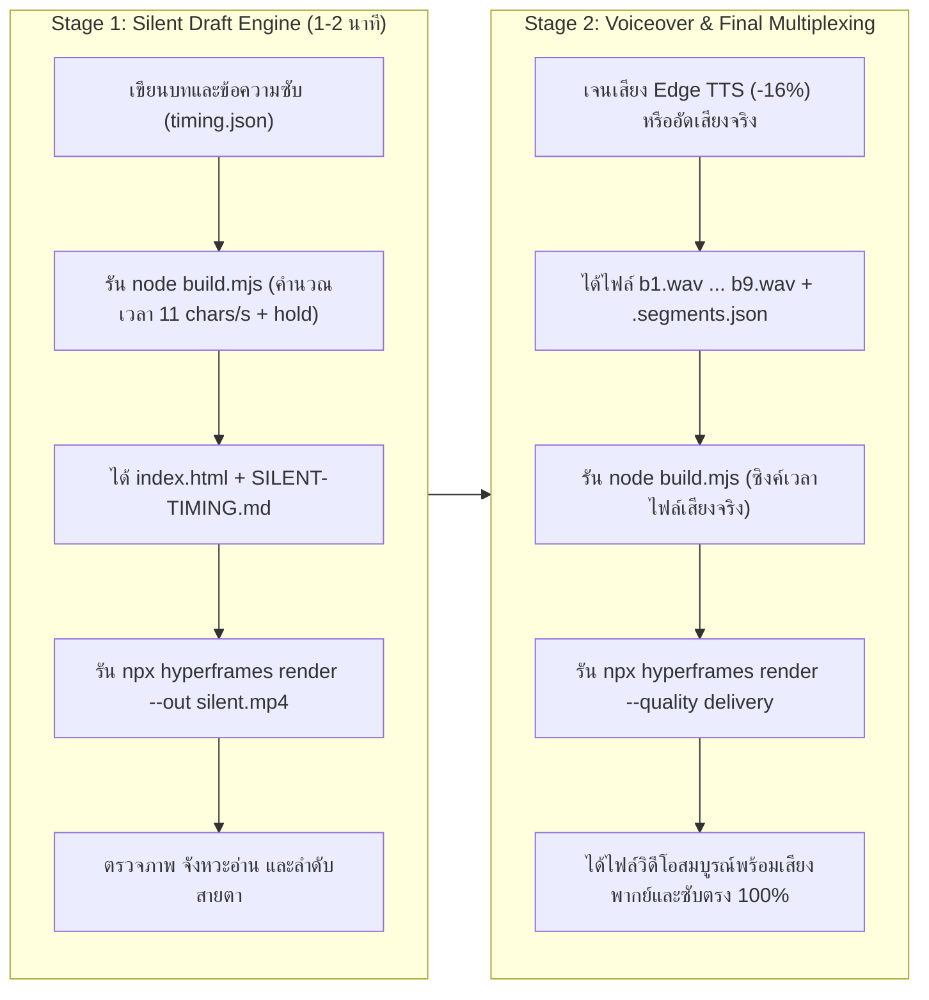

# Workflow — ระบบวางแผนและผลิตวิดีโอ (EP04-EP11 Master Standard)

เอกสารนี้กำหนดกระบวนการทำงานมาตรฐาน (Standard Operating Procedure: SOP) ในการผลิตวิดีโออธิบาย LangMind API แนวตั้ง (1080×1920 30fps) โดยอ้างอิงและถอดแบบพิมพ์เขียวจากความสำเร็จของ **EP04 v3 และ EP06–EP11**

ใช้ควบคู่กับสกิล [langmind-video-producer](../.agents/skills/langmind-video-producer/SKILL.md) และเอกสาร [langmind-api.md](../langmind-api.md)

---

## 1. เสาหลักมาตรฐานการผลิต (Core Standards)

1. **โจทย์จากมุมคนดู (Audience-First)**:
   * ทุกคลิปเริ่มจากปัญหาในชีวิตจริงของ Developer หรือเจ้าของธุรกิจ ไม่เปิดคลิปด้วยการท่องชื่อ Endpoint
   * ตั้ง 3 คำถามหลักเป็นแกนดำเนินเรื่อง: **เตรียมอะไร? → เชื่อมตรงไหน? → ใช้ผลยังไง?**
2. **โครงเรื่อง 9 ช่วง (The 9-Beat Narrative Blueprint)**:
   * **b1 (Hook)**: ปัญหาหน้าจอแอป + ตัวละคร Robot + ชิป 3 คำถาม
   * **b2 (Architecture)**: แผนผัง 3 ส่วน (หลังบ้าน ⇄ LangMind ⇄ Agent) + 3 ขั้นตอนหลัก
   * **b3 (Prerequisites)**: เตรียม 3 อย่าง (Agent & Config + API Key Scopes + Server Key Safety)
   * **b4 (Call #1)**: เชื่อมครั้งที่ 1 (เตรียม/ส่งข้อมูลตั้งต้น + Minimap เขียว)
   * **b5 (Call #2)**: เชื่อมครั้งที่ 2 (ประมวลผล/ผูกระบบ + Minimap ทอง)
   * **b6 (Call #3)**: เชื่อมครั้งที่ 3 (ทดสอบดึงผลลัพธ์ + Minimap เขียวน้ำทะเล + หน้าจอผลลัพธ์)
   * **b7 (How to Use & Gotchas)**: การนำผลไปใช้ต่อ, ทางเลือกเสริม (batch/stream), และข้อควรระวังสำคัญ
   * **b8 (Summary)**: สรุป 3 เสาหลัก (เตรียม → เชื่อม 3 ครั้ง → ใช้ผล)
   * **b9 (Sponsor & CTA)**: โลโก้ LangMind ขยายเด่น + `langmind.in.th`
3. **ระบบภาพ Editorial Paper & Sage Ink**:
   * พื้นหลังกระดาษอุ่นสบายตา (`#fcfbf7`), การ์ดสีขาวขอบมน (`#ffffff`), ตัวหนังสือหมึกเข้ม (`#2c2825`)
   * ฟอนต์ภาษาไทย **Sarabun** (Regular/Bold) ฝังใน `assets/fonts/` ภายในเครื่อง Render แบบ Offline 100%
   * แอนิเมชัน GSAP แบบ **Seek-Safe** (ใช้ `fromTo`, `set`, และ absolute time ใน `motion.js`)
   * Mockup อุปกรณ์มือถือคมชัด 1440×1800 px พร้อมระบบสลับสถานะ 2 เลเยอร์ (`img` และ `img-a`)
4. **ความถูกต้องทางเทคนิคและความปลอดภัย (API & Claim Integrity)**:
   * ตรวจสอบ Method, Endpoint, Header, และ Scopes กับ `langmind-api.md` ทุกจุด
   * ห้ามมี Secret หรือ API Token จริงในโค้ดหรือวิดีโอ (ใช้ Token จำลอง `lmpat_••••••••`)
   * ป้ายหน้าจอจำลองต้องระบุ "ภาพจำลอง" ชัดเจน ไม่แอบอ้างเป็น Official UI หรือผลเรียกสด

---

## 2. กระบวนการผลิต 2 ระดับ (Two-Stage Production Protocol)

เพื่อความรวดเร็วและประสิทธิภาพสูงสุด การผลิตวิดีโอจะแบ่งเป็น 2 สเตจ:



### Stage 1: Fast Silent Draft Mode
* **เป้าหมาย**: ตรวจสอบความถูกต้องของเนื้อหา เลย์เอาต์ อนิเมชัน และการตัดบรรทัดซับไตเติลอย่างรวดเร็ว
* **การคำนวณเวลา**: `build.mjs` ประเมินความยาวแต่ละประโยคจากอัตราอ่าน 11 ตัวอักษร/วินาที + ช่องไฟ 0.35 วินาที พร้อมเพิ่มเวลา `hold` สำหรับบล็อกโค้ดหรือไดอะแกรมซับซ้อน (2.0–3.5 วินาที)
* **ผลลัพธ์**: ได้ไฟล์ `*-silent.mp4` ความละเอียดเต็ม 1080×1920 30fps และเอกสาร `SILENT-TIMING.md` สำหรับตรวจรับงานภาพทันทีโดยไม่ต้องรอไฟล์เสียง

### Stage 2: Voiceover Integration Mode
* **เป้าหมาย**: เติมเสียงบรรยายที่คมชัด เป็นธรรมชาติ และซิงค์จังหวะซับไตเติลระดับเฟรม
* **การสร้างเสียง**: ใช้สคริปต์ `make-voice-samples.py` สังเคราะห์เสียง Edge TTS (`th-TH-NiwatNeural` ปรับความเร็ว `-16%` เพื่อการฟังที่ชัดเจนและอ่านซับทัน) พร้อมตัด Silence หัวท้าย หรือนำเข้าไฟล์เสียงพากย์จริง
* **การซิงค์เวลา**: เมื่อรัน `node build.mjs` ระบบจะอ่านเวลาจริงจากไฟล์เสียงและตัวระบุตำแหน่ง `.segments.json` เข้าสู่ `window.FILM` ใน `index.html` โดยอัตโนมัติ

---

## 3. ลำดับขั้นตอนการทำงาน (W0 – W7 Lifecycle)

| ขั้นตอน | หน้าที่และผลส่งมอบ | เงื่อนไขการไปต่อ |
|---|---|---|
| **W0: ขอบเขตงาน** | กำหนดตอนที่ต้องการทำและเลือกหัวข้อ API จาก `langmind-api.md` | ขอบเขตตอนชัดเจน มีเอกสาร API รองรับ |
| **W1: ตรวจความพร้อม** | ตรวจสอบทักษะ `langmind-video-producer` และ HyperFrames CLI ในระบบ | สกิลพร้อมใช้งาน คำสั่ง `npx hyperframes` ใช้งานได้ |
| **W2: ระบบภาพกลาง** | ใช้ธีม Editorial Paper & Sage Ink, ฟอนต์ Sarabun, และ Mascot Robot จาก `shared/` | โครงสร้างโฟลเดอร์และ Assets กลางพร้อม |
| **W3: ออกแบบเรื่อง 9 Beat** | จัดทำ `PLAN.md` (โจทย์คนดู, โครง 9 Beat, Claim Ledger) และ `SCRIPT.md` (บทร่าง) | ตรวจสอบ Claims กับคู่มือ API เรียบร้อย |
| **W4: Storyboard & Mockup** | จัดทำ `STORYBOARD.md`, เตรียมภาพ Mockup 1440×1800 px 2 ภาพ (`app-*-1.jpg`, `app-*-2.jpg`) | มีภาพ Mockup ครบ และระบุป้ายภาพจำลอง |
| **W5: ประกอบโค้ด & Build** | สร้าง `timing.json`, ปรับ `build.mjs`, รัน `node build.mjs` และ `npx hyperframes check` | `npx hyperframes check` ได้ 0 errors |
| **W6: Render ตรวจสอบ (Stage 1)** | Render วิดีโอ `*-silent.mp4` ตรวจสอบความถูกต้องและบันทึกผลลงใน `REVIEW.md` | ผ่านเกณฑ์ Technical และ Visual Gates |
| **W7: เสียงพากย์ & ส่งมอบ (Stage 2)** | สร้างไฟล์เสียงด้วย `make-voice-samples.py`, รัน `build.mjs`, Render ฉบับ Delivery | ผ่านเกณฑ์ Storytelling, Audio และ Claims Gates |

---

## 4. มาตรฐานไฟล์และโครงสร้างโฟลเดอร์ประจำตอน

ทุก Episode ในโฟลเดอร์ `episodes/epXX-<slug>/` ต้องมีไฟล์ตามผังนี้:

```text
episodes/epXX-<slug>/
├── README.md                      # สรุปสถานะ วิดีโอ draft ล่าสุด และ next actions
├── PLAN.md                        # แผนงาน W3, use case, 9 beat, claim ledger
├── SCRIPT.md                      # บทพากย์ภาษาพูด 9 beat และข้อความซับ
├── STORYBOARD.md                  # ข้อกำหนดภาพ Mockup และ storyboard ราย beat
├── CATALOG.md                     # ทะเบียน motion components และจุดตรวจ W5
└── video/                         # HyperFrames workspace
    ├── assets/
    │   ├── fonts/                 # Sarabun-Regular.ttf, Sarabun-Bold.ttf
    │   ├── gsap.min.js            # Standalone GSAP engine
    │   ├── langmind-logo.png      # โลโก้แบรนด์
    │   ├── <robot-pose>.png       # หุ่นยนต์ Mascot ประจำตอน
    │   ├── app-<slug>-1.jpg       # Mockup เริ่มต้น (1440x1800)
    │   ├── app-<slug>-2.jpg       # Mockup ผลลัพธ์ (1440x1800)
    │   └── voice/                 # (ใส่ใน Stage 2) b1.wav ... b9.wav + .segments.json
    ├── build.mjs                  # Script คอมไพเลอร์ timing.json -> index.html
    ├── timing.json                # ตารางกำหนดเวลาและข้อความเสียง/ซับ 9 Beat
    ├── index.html                 # Markup composition หลัก (สร้างอัตโนมัติ)
    ├── style.css                  # Master CSS ธีม Editorial Paper & Sage Ink
    ├── motion.js                  # ระบบควบคุมอนิเมชัน GSAP แบบ Seek-Safe
    ├── SILENT-TIMING.md           # ตารางเวลาอ่านสำหรับวางเสียง (สร้างอัตโนมัติ)
    ├── VOICE-SCRIPT.md            # บทรวมเสียงพากย์สำหรับนักพากย์ (สร้างอัตโนมัติ)
    ├── REVIEW.md                  # ผลตรวจ technical, visual, storytelling และ audio
    └── make-voice-samples.py      # สคริปต์ Edge TTS สำหรับสร้างเสียงพากย์
```

---

## 5. เกณฑ์การตรวจรับงาน (Quality Verification Gates)

การส่งมอบงานต้องผ่านจุดตรวจ 5 ด้านตามที่กำหนดใน [REVIEW.template.md](../.agents/skills/langmind-video-producer/templates/REVIEW.template.md):

1. **Technical Gate**: `npx hyperframes check` 0 errors, local assets resolve ครบ 100%, วิดีโอ decode ผ่าน ไม่กระตุกขณะ seek
2. **Visual & Layout Gate**: สีและสไตล์ตรงตาม Editorial Paper & Sage Ink, ฟอนต์ Sarabun คมชัด, ตัวหนังสือไทยไม่ขาดวรรค, ป้าย Minimap แสดงสีตรงขั้นตอน
3. **Storytelling Gate**: ครบ 9 Beat ตามโครงเรื่องมาตรฐาน, แยกหน้าที่ API/Developer ชัดเจน, ปิดท้ายด้วยฉากผู้สนับสนุน LangMind
4. **Audio & Timing Gate**: เวลาอ่านของ Silent Draft สมเหตุสมผล, เสียงพากย์ไม่ทับซ้อนและตรงกับซับไตเติลคำต่อคำ
5. **API & Claims Gate**: Endpoint, Method, Header, และ Scopes ตรงกับ `langmind-api.md` 100%, ไม่มี Secret จริงหลุดในสื่อ
