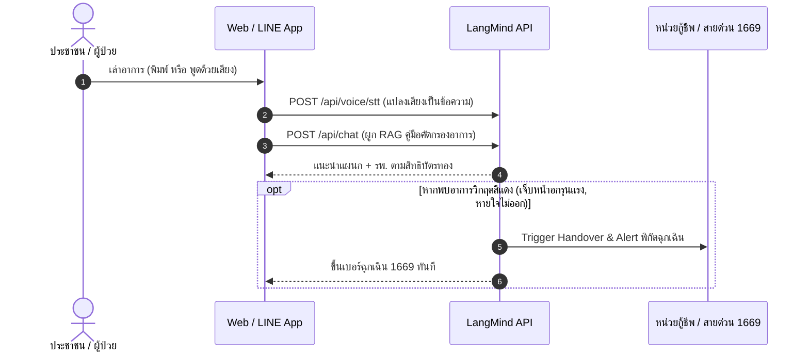

# 01 — Use Cases เพื่อประโยชน์สังคมและสาธารณะ (Social Impact & Public Good)

รวมแนวคิดการนำ LangMind API ไปสร้างโซลูชันเพื่อการพัฒนาคุณภาพชีวิต ชุมชน และสาธารณประโยชน์

---

## 1. AI คัดกรองอาการและสิทธิบัตรทองเบื้องต้น (Community Healthcare Triage)

### โจทย์และปัญหา
- ประชาชนในชุมชนหรือพื้นที่ห่างไกลมักเดินทางมาห้องฉุกเฉินโรงพยาบาลด้วยอาการเจ็บป่วยเล็กน้อย ทำให้บุคลากรทางการแพทย์ล้นมือ ขณะเดียวกัน ผู้ป่วยบางรายที่มีอาการวิกฤตกลับประเมินตนเองไม่ถูกจนไป รพ. ช้าเกินไป
- ปัญหาความสับสนเรื่องสิทธิการรักษา (บัตรทอง 30 บาท, ประกันสังคม, สิทธิข้าราชการ) และขั้นตอนการส่งตัว

### กลไกการทำงานด้วย LangMind API

### การต่อยอดเป็นตอนในวิดีโอ
- **Beats b4–b6**: 1) ผู้ป่วยกดอัดเสียงเล่าอาการ 2) AI เทียบคู่มือการแพทย์และสิทธิสถานพยาบาล 3) ส่งต่อข้อมูลให้ อสม. หรือเรียกรถฉุกเฉิน

---

## 2. ผู้ช่วยอ่านและอธิบายภาษากฎหมาย/สัญญาสำหรับผู้พิการ (Accessibility & Legal Aid)

### โจทย์และปัญหา
- เอกสารราชการ สัญญาเช่าที่ดิน หรือข้อกำหนดกฎหมายแรงงาน มักใช้ภาษาที่เป็นทางการและซับซ้อน ทำให้ผู้สูงอายุ ผู้มีข้อจำกัดในการอ่าน หรือผู้พิการทางสายตา ตกเป็นเหยื่อของการถูกเอาเปรียบ

### กลไกการทำงานด้วย LangMind API
- **อัปโหลดเอกสารต้นฉบับ**: ใช้ [Knowledge API (EP06)](../episodes/ep06-knowledge-rag/README.md) อัปโหลดไฟล์ PDF สัญญาหรือประกาศราชการ
- **สรุปสาระสำคัญ**: สั่ง Prompt ให้สรุปออกมาเป็น 3 ประเด็นสำคัญ: *“เราต้องจ่ายอะไรบ้าง”, “เรามีสิทธิอะไร”, “ห้ามทำอะไรเด็ดขาด”*
- **อ่านออกเสียงภาษาไทยธรรมชาติ**: ใช้ [Voice TTS (EP04)](../episodes/ep04-voice-api/README.md) สังเคราะห์เสียงพูดที่ชัดถ้อยชัดคำ นุ่มนวล เพื่อให้ผู้ฟังสามารถรับฟังและเข้าใจได้ง่าย

---

## 3. ติวเตอร์ AI สอนการบ้านเด็กในโรงเรียนห่างไกล (Personalized Education Tutor)

### โจทย์และปัญหา
- ความเหลื่อมล้ำทางการศึกษา: โรงเรียนขนาดเล็กในชนบทขาดแคลนครูเฉพาะทาง (เช่น ครูสอนฟิสิกส์ หรือภาษาอังกฤษ) เด็กนักเรียนไม่มีที่ปรึกษาเวลาทำการบ้านนอกเวลาเรียน

### กลไกการทำงานด้วย LangMind API
- **คลังความรู้ตามหลักสูตร**: นำเข้าแบบเรียนและเฉลยของกระทรวงศึกษาธิการเข้า [Knowledge Datasets (EP06)](../episodes/ep06-knowledge-rag/README.md)
- **Socratic Prompting**: กำหนด Agent ให้ใช้วิธีสอนแบบตั้งคำถามกระตุ้นความคิดทีละสเต็ป ไม่ใช่การบอกคำตอบตรงๆ
- **ครูติดตามผลผ่าน Analytics**: คุณครูสามารถเปิดดู [Analytics Dashboard (EP09)](../episodes/ep09-analytics-feedback/README.md) เพื่อดูว่าหัวข้อบทเรียนใดที่เด็กเข้ามาถามซ้ำบ่อยที่สุด เพื่อนำมาเน้นสอนในชั้นเรียนจริง

---

## 4. เพื่อนรับฟังและปฐมพยาบาลจิตใจตลอด 24 ชม. (Mental Health First-Aid Listener)

### โจทย์และปัญหา
- ผู้ที่มีภาวะเครียด ซึมเศร้า หรือหมดไฟ มักต้องการคนรับฟังในช่วงเวลากลางดึก ซึ่งสายด่วนสุขภาพจิตมักมีผู้ใช้บริการหนาแน่นและคู่สายเต็ม

### กลไกการทำงานด้วย LangMind API
- **เชื่อมต่อผ่าน LINE OA**: ใช้งานสะดวก ประชาชนไม่ต้องลงแอปใหม่ ใช้ [LINE Channel (EP10)](../episodes/ep10-inbox-line-channel/README.md)
- **Safe Response Boundary**: ตั้ง [Simple Knowledge (EP07)](../episodes/ep07-simple-knowledge-candidates/README.md) ดักจับกลุ่มคำความเสี่ยงสูง (Self-harm keywords)
- **สลับเคสวิกฤตสู่ผู้เชี่ยวชาญ**: เมื่อพบความเสี่ยง ระบบจะทำการ Handover แจ้งเตือนไปยังทีมนักจิตวิทยาอาสา หรือแสดงช่องทางติดต่อสายด่วน 1323 ทันที

---

## 5. ระบบประสานงานน้ำท่วมและแจกถุงยังชีพฉุกเฉิน (Disaster Relief Coordinator)

### โจทย์และปัญหา
- เมื่อเกิดภัยพิบัติฉุกเฉิน (เช่น น้ำท่วมฉับพลัน ดินถล่ม) เจ้าหน้าที่รับสายไม่ทัน ประชาชนไม่ทราบว่าจุดแจกถุงยังชีพ จุดอพยพ หรือเส้นทางที่น้ำท่วมตัดขาดอยู่ที่ใด

### กลไกการทำงานด้วย LangMind API
- **ข้อมูลเรียลไทม์ผ่าน Simple FAQ**: เจ้าหน้าที่อัปเดตจุดแจกของและระดับน้ำลง [Simple Knowledge (EP07)](../episodes/ep07-simple-knowledge-candidates/README.md) ซึ่งอัปเดตปุ๊บ บอตตอบข้อมูลใหม่ได้ทันทีโดยไม่ต้องรอเทรนใหม่
- **รับแจ้งความเดือดร้อน**: ประชาชนส่งพิกัดและจำนวนผู้ติดค้างผ่านแชท บันทึกเข้า [Inbox API (EP10)](../episodes/ep10-inbox-line-channel/README.md) เพื่อให้ทีมกู้ภัยเปิดดูรายการเคสและติ๊กรับภารกิจช่วยเหลือ

---

## 6. หมอพืชชุมชน: วินิจฉัยโรคพืชและแมลงศัตรูพืช (Smart Agriculture Advisor)

### โจทย์และปัญหา
- เกษตรกรรายย่อยเมื่อพืชผลเกิดใบเหลืองหรือมีแมลงระบาด มักไปร้านเคมีเกษตรและถูกแนะนำยาฆ่าแมลงราคาแพงเกินจำเป็นและอาจตกค้างในสิ่งแวดล้อม

### กลไกการทำงานด้วย LangMind API
- **ฐานข้อมูลคู่มือเกษตรกรรม**: นำเข้าองค์ความรู้จากกรมวิชาการเกษตร (โรคข้าว, โรคทุเรียน, ศัตรูพืชพืชสวน)
- **วินิจฉัยและแนะนำทางเลือกปลอดภัย**: เกษตรกรพิมพ์เล่าอาการ หรือพูดด้วยเสียง AI ค้นคืนวิธีรักษาด้วยวิธีชีวภาพหรือสารอินทรีย์ก่อนใช้สารเคมี
- **เก็บคำถามใหม่ที่ไม่เคยพบ**: หากเป็นโรคพืชสายพันธุ์ใหม่ คำถามจะถูกเก็บเข้า [Knowledge Candidates (EP07)](../episodes/ep07-simple-knowledge-candidates/README.md) ให้นักวิชาการเกษตรเข้ามาตรวจสอบและอัปเดตคำตอบเข้าสู่ระบบ
