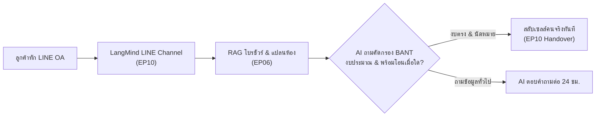

# 02 — Use Cases ภาคธุรกิจและองค์กร (Business & Enterprise Solutions)

รวมแนวคิดการนำ LangMind API ไปเพิ่มประสิทธิภาพ ลดต้นทุน และขับเคลื่อนยอดขายในองค์กรธุรกิจและ SME

---

## 1. อสังหาริมทรัพย์: คัดกรองลูกค้ามุ่งหวัง & จองคิวชมโครงการ (Real Estate Lead Qualifier)

### โจทย์และปัญหา
- ทีมขายเสียเวลาวันละหลายชั่วโมงในการตอบคำถามเดิมๆ เช่น ขนาดห้อง, ทิศระเบียง, ค่าส่วนกลาง, สถานะห้องว่าง แต่เมื่อได้คุย กลับพบว่าลูกค้าไม่มีงบหรือยังไม่พร้อมซื้อจริง

### สถาปัตยกรรมระบบด้วย LangMind API

### สิ่งที่ทำให้โดดเด่นในคลิป
- หน้าจอจำลองมือถือลูกค้าทักคุย ถามราคาและโปรโมชัน
- ฝั่งหลังบ้านแสดงแผง Inbox ที่บอตสรุปข้อมูลลูกค้า: *“คุณสมชาย, งบ 5 ล้าน, สนใจ 2 ห้องนอน ทิศเหนือ, สะดวกเข้าชมวันเสาร์ 14:00 น.”* ทำให้เซลส์ปิดการขายได้ง่ายดาย

---

## 2. คลินิกความงามและทันตกรรม: บอตประเมินคอร์ส & นัดหมอ (Clinic & Aesthetic Bot)

### โจทย์และปัญหา
- ลูกค้าคลินิกมักทักถามตอน 4 ทุ่ม - เที่ยงคืน ซึ่งแอดมินเลิกงานแล้ว ถ้าตอบช้า ลูกค้าจะเปลี่ยนใจไปทักคลินิกอื่น
- ข้อมูลหัตถการทางการแพทย์และราคามีความละเอียดอ่อน ห้าม AI ตอบมั่วหรือเคลมเกินจริงเด็ดขาด

### กลไกการทำงานด้วย LangMind API
- **ความแม่นยำด้านราคา**: ใช้ [Simple Knowledge (EP07)](../episodes/ep07-simple-knowledge-candidates/README.md) ตอบราคาคอร์สและเงื่อนไขโปรโมชันตายตัว
- **คู่มือการเตรียมตัว**: ใช้ [Knowledge Datasets (EP06)](../episodes/ep06-knowledge-rag/README.md) ดึงข้อมูลการเตรียมตัวก่อนทำเลเซอร์ และข้อห้ามหลังฉีดโบท็อกซ์/ฟิลเลอร์
- **จองสล็อตปรึกษาแพทย์**: สลับเข้าแชทแอดมินเพื่อนัดวันพบแพทย์ผู้เชี่ยวชาญ

---

## 3. โรงแรมและการท่องเที่ยว: ผู้ช่วยเสียงประจำห้องพัก (In-Room Voice Concierge)

### โจทย์และปัญหา
- แผนกต้อนรับและโอเปอเรเตอร์รับสายโทรศัพท์ทั้งวันจากแขกในห้องพักเรื่องเดิมๆ เช่น ขอรหัส Wi-Fi, เมนูอาหารเช้า, เวลาเปิดสระว่ายน้ำ, ขอยืมเตารีด

### กลไกการทำงานด้วย LangMind API
- **แท็บเล็ตในห้องพัก**: มีปุ่มกดคุยเสียงภาษาไทยและอังกฤษผ่าน [Voice STT & TTS (EP04)](../episodes/ep04-voice-api/README.md)
- **คลังข้อมูลโรงแรมครบวงจร**: เชื่อมต่อข้อมูลคู่มือบริการโรงแรมและสถานที่ท่องเที่ยวรอบข้างผ่าน [Knowledge API (EP06)](../episodes/ep06-knowledge-rag/README.md)
- **สั่งอาหารและบริการ**: บอตทวนรายการสั่งรูมเซอร์วิสเป็นเสียงพูดอย่างสุภาพ แล้วส่งข้อความเข้าห้องครัว

---

## 4. องค์กรและฝ่ายบุคคล: ศูนย์รวมข้อมูลสวัสดิการพนักงาน (Internal HR & Policy Portal)

### โจทย์และปัญหา
- พนักงานใหม่ถามคำถามเดิมซ้ำๆ: *“เบิกค่าทำฟันได้เท่าไหร่”, “ลาคลอดได้กี่วัน”, “ประกันกลุ่มครอบคลุมอะไรบ้าง”* ซึ่งเอกสารอยู่ใน PDF รวมหลายร้อยหน้าที่ไม่มีใครเปิดอ่าน

### กลไกการทำงานด้วย LangMind API
- **อัปโหลดเอกสารระเบียบองค์กร**: นำไฟล์ PDF กฎระเบียบบริษัททั้งหมดเข้าสู่ [Knowledge Datasets (EP06)](../episodes/ep06-knowledge-rag/README.md)
- **ระบบเก็บคำถามตกหล่น (Knowledge Candidates)**: เมื่อพนักงานถามนโยบายใหม่ที่เพิ่งประกาศแต่ยังไม่อยู่ในคู่มือ ระบบจะดักจับคำถามไว้ที่ [EP07 Candidates](../episodes/ep07-simple-knowledge-candidates/README.md) ให้ฝ่าย HR เติมคำตอบได้ใน 1 นาที
- **Analytics วัดความสนใจ**: HR ดูสถิติได้ว่าช่วงนี้พนักงานกังวลเรื่องอะไรมากที่สุดจาก [EP09 Analytics](../episodes/ep09-analytics-feedback/README.md)

---

## 5. ประกันภัยและการเงิน: ผู้ช่วยเปรียบเทียบกรมธรรม์และแนะนำการเคลม (Insurance Explainer)

### โจทย์และปัญหา
- เงื่อนไขตารางกรมธรรม์ประกันสุขภาพและประกันอุบัติเหตุมีความซับซ้อน ลูกค้ามักไม่เข้าใจว่าเคสไหนเบิกได้ เคสไหนติดเงื่อนไขสำรองจ่าย

### กลไกการทำงานด้วย LangMind API
- **อธิบายตารางผลประโยชน์**: AI นำข้อมูลตารางความคุ้มครองมาสรุปเปรียบเทียบเป็นภาษาง่ายๆ พร้อมเน้นย้ำข้อยกเว้นสำคัญ
- **คู่มือแจ้งเคลมด่วน (FNOL)**: เมื่อเกิดอุบัติเหตุ AI ให้คำแนะนำขั้นตอนการถ่ายรูปหลักฐาน และเตรียมเอกสารส่งเคลมทันที
- **วัดคะแนนความพึงพอใจ**: ติดตั้งปุ่ม Thumb-up / Thumb-down ผ่าน [EP09 Feedback API](../episodes/ep09-analytics-feedback/README.md) เพื่อนำไปปรับปรุง Prompt ให้ตรงจุด

---

## 6. ร้านอาหารและแฟรนไชส์: AI รับสายโทรสั่งอาหาร 24 ชม. (Voice Phone Ordering)

### โจทย์และปัญหา
- ช่วงเวลาพีค (เที่ยง/เย็น) พนักงานหน้าร้านวุ่นกับการเสิร์ฟและทำอาหารจนไม่มีคนรับโทรศัพท์ ทำให้เสียออเดอร์เดลิเวอรีและออเดอร์จัดเลี้ยงล่วงหน้า

### กลไกการทำงานด้วย LangMind API
- **รับสายโทรศัพท์ทันที**: เชื่อมต่อเบอร์โทรผ่าน Voice Gateway เข้าสู่ [Voice STT (EP04)](../episodes/ep04-voice-api/README.md)
- **เช็กวัตถุดิบและสารก่อภูมิแพ้**: ตอบคำถามเรื่องส่วนผสม (เช่น มีถั่วไหม, วีแกนทานได้ไหม) ได้อย่างแม่นยำ
- **รับออเดอร์พร้อมทวนยอด**: AI สรุปรายการอาหาร ยอดเงิน และเวลาที่จะมารับ พร้อมส่งข้อมูลเข้าจอ POS ในครัว
