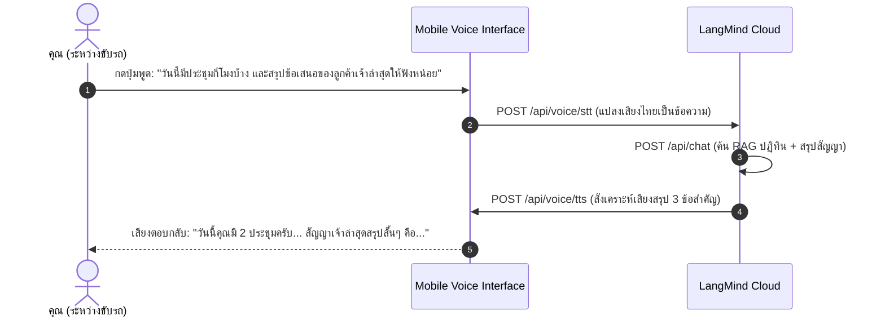

# 03 — Use Cases เลขาส่วนตัวและผู้ช่วยส่วนตัว (Personal Assistant & Second Brain)

รวมแนวคิดการนำ LangMind API มาสร้างระบบผู้ช่วยส่วนบุคคลสำหรับผู้บริหาร ฟรีแลนซ์ และผู้ที่ต้องการเพิ่มผลผลิต (Productivity) ขั้นสุด

---

## 1. เลขาเสียงส่วนตัวตอนขับรถ (Voice-First Chief of Staff)

### โจทย์และปัญหา
- ผู้บริหารหรือเจ้าของธุรกิจใช้เวลาบนรถวันละ 1–2 ชั่วโมง แต่ไม่สามารถอ่านเอกสารยาวๆ หรือพิมพ์ตอบข้อความได้
- ต้องการเลขาส่วนตัวที่สามารถพูดคุยโต้ตอบเป็นภาษาไทย สอบถามตารางงาน และสรุปประเด็นสัญญาสำคัญให้ฟังระหว่างเดินทาง

### กลไกการทำงานด้วย LangMind API

### ฟังก์ชันที่นำมาใช้
- **[EP04 Voice STT & TTS](../episodes/ep04-voice-api/README.md)**: ถอดความคำพูดภาษาไทยแม่นยำ และสร้างเสียงพูดที่ฟังลื่นหู ไม่กระตุก
- **[EP06 Knowledge RAG](../episodes/ep06-knowledge-rag/README.md)**: ฐานข้อมูลเอกสาร สัญญา และบันทึกสรุปโปรเจกต์ส่วนตัว
- **[EP08 Chat History](../episodes/ep08-chat-history/README.md)**: จดจำบทสนทนาต่อเนื่อง สามารถสั่ง *"ข้อที่ 2 ช่วยเล่ารายละเอียดเพิ่มหน่อย"* ได้อย่างเป็นธรรมชาติ

---

## 2. สมองที่สองส่วนตัว (Personal Second Brain & Research Archive)

### โจทย์และปัญหา
- คนเราอ่านหนังสือ อ่านบทความวิจัย จดโน้ตใน Notion/Obsidian หรือฟัง Podcast รวมไว้มากมาย แต่เมื่อถึงเวลาต้องนำมาใช้ทำงานจริง กลับหาไม่เจอ หรือจำไม่ได้ว่าเคยอ่านมาจากที่ไหน

### กลไกการทำงานด้วย LangMind API
- **อัปโหลดคลังโน้ตทั้งหมด**: นำไฟล์ Markdown, บันทึกการประชุม (Meeting Notes), สไลด์ และไฟล์ PDF หนังสือทั้งหมด อัปโหลดเข้า [Knowledge Datasets (EP06)](../episodes/ep06-knowledge-rag/README.md)
- **สืบค้นเชิงความหมาย (Semantic Retrieval)**: เวลาถาม เช่น *"วิธีแก้ปัญหาการเจรจาต่อรองเมื่อลูกค้าขอตัดราคา ฉันเคยบันทึกอะไรไว้บ้าง?"* AI จะสแกนค้นหาไอเดียเก่าๆ มาสรุปให้ทันที
- **อ้างอิงแหล่งที่มาแม่นยำ**: ตอบกลับพร้อมบอกชื่อไฟล์และหน้าที่ดึงข้อมูลมา ทำให้มั่นใจว่าไม่มีการแต่งเนื้อหาขึ้นเอง (No Hallucination)

---

## 3. ผู้ช่วยร่างอีเมลและเตรียมตัวก่อนเข้าประชุม (Pre-Meeting Briefing Assistant)

### โจทย์และปัญหา
- มีนัดประชุมกับลูกค้าหรือพาร์ทเนอร์ใหม่ แต่ไม่มีเวลาอ่านประวัติบริษัทหรือเอกสารนำเสนอล่วงหน้า

### กลไกการทำงานด้วย LangMind API
- **บรีฟสรุปใน 30 วินาที**: อัปโหลดข้อมูลบริษัทลูกค้าหรือใบเสนอราคา แล้วสั่ง AI: *"เตรียม 3 คำถามทรงพลังสำหรับการคุยครั้งนี้ และสรุปจุดที่ควรระวังในการเจรจา"*
- **ร่างอีเมลขอบคุณหลังประชุม (Follow-up Email)**: เพียงแค่พูดบันทึกเสียงสั้นๆ หลังเดินออกจากห้องประชุม AI จะแปลงเป็นร่างอีเมลภาษาอังกฤษหรือภาษาไทยระดับมืออาชีพ พร้อมส่งให้เราตรวจก่อนกด Send
