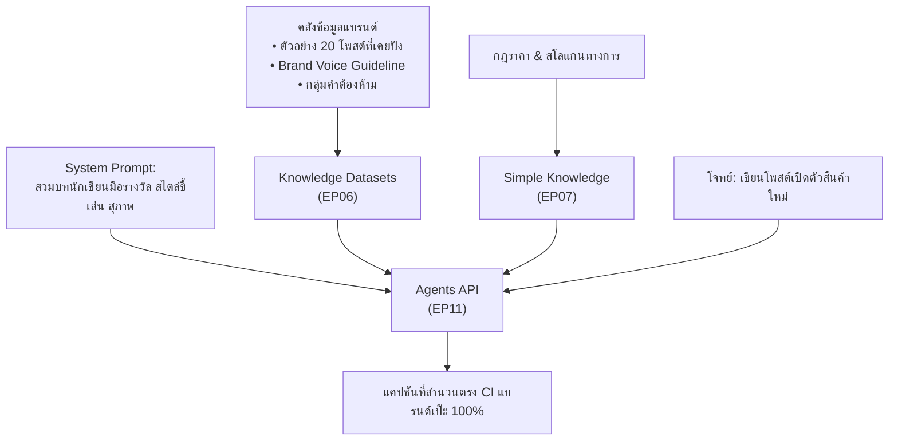

# 04 — Use Cases การตลาดและการหาลูกค้า (Marketing & Lead Generation)

รวมแนวคิดการนำ LangMind API มาสร้างระบบการตลาดอัตโนมัติ การคัดกรองลูกค้ามุ่งหวัง และการปิดการขายอย่างแม่นยำ

---

## 1. นักเขียนประจำแบรนด์ที่คุมโทนเสียงได้ 100% (Brand-Voice Copywriting Engine)

### โจทย์และปัญหา
- การใช้ Generic AI (เช่น ChatGPT ดิบๆ) เขียนแคปชัน มักได้ภาษาที่ดูเป็นหุ่นยนต์ ใช้คำซ้ำซาก (เช่น "ก้าวเข้าสู่อนาคต", "พลิกโฉม") และไม่ตรงกับบุคลิกของแบรนด์ (Brand Persona)

### กลไกการทำงานด้วย LangMind API

### จุดเด่นในการทำเป็นคลิป
- โชว์การทดสอบสองหน้าจอ (A/B Test): บอตที่ไม่มี RAG ตอบแบบแข็งทื่อ VS บอตที่ผูก LangMind RAG ตอบสำนวนคนไทย อ่านเพลิน ตรงสไตล์แบรนด์

---

## 2. บอตคัดกรองลูกค้าใน LINE OA 24 ชม. + ส่งต่อปิดการขาย (Smart Inbound Lead Qualifier)

### โจทย์และปัญหา
- ยิงแอด Facebook / TikTok แล้วมีคนทัก LINE OA เข้ามาวันละหลายร้อยคน แอดมินตอบไม่ทัน และส่วนใหญ่เป็นเพียงคนทักเล่นๆ แต่ลูกค้าที่มีงบพร้อมจ่ายจริงกลับต้องรอนานจนหนีไปซื้อเจ้าอื่น

### สถาปัตยกรรมระบบ
1. **ต้อนรับและคัดกรองด้วย BANT Framework**:
   - **B (Budget)**: บอตชวนคุยประเมินระดับงบประมาณที่ลูกค้าตั้งไว้
   - **A (Authority)**: ผู้ตัดสินใจเอง หรือต้องเสนอผู้บริหาร
   - **N (Need)**: ปัญหาที่ต้องการให้แก้ไข
   - **T (Timeline)**: ต้องการเริ่มใช้งานเมื่อใด
2. **การสลับคนจริง (Inbox Handover - [EP10](../episodes/ep10-inbox-line-channel/README.md))**:
   - หากประเมินเป็นลูกค้าระดับ High-Value ระบบจะส่ง Notification เข้ามือถือของเซลส์ทันที พร้อมสรุปสเปกที่ลูกค้าต้องการใน 3 บรรทัด
   - เซลส์กดปุ่มรับเคส (Takeover) เข้าคุยต่ออย่างไร้รอยต่อ

---

## 3. ผู้ช่วยร่างใบเสนอราคาและข้อเสนอโครงการ (Instant Proposal & Rate Card Matcher)

### โจทย์และปัญหา
- หลังคุยกับลูกค้าเสร็จ เซลส์ต้องใช้เวลาทำ Proposal และคำนวณราคา 1–2 วัน ทำให้ความสนใจของลูกค้าลดลง

### กลไกการทำงานด้วย LangMind API
- **คลัง Rate Card และเคสศึกษา**: อัปโหลดแพ็กเกจราคาและ Scope of Work มาตรฐานเข้าสู่ [Knowledge API (EP06)](../episodes/ep06-knowledge-rag/README.md)
- **สร้างข้อเสนออัตโนมัติ**: ส่งข้อความสรุปความต้องการของลูกค้าเข้าสู่ Agent ระบบจะดึง Package ที่เหมาะสม คำนวณราคา พร้อมร่างโครงสร้างข้อเสนอ 3 ส่วน: *ปัญหาของลูกค้า → โซลูชันที่เรานำเสนอ → ตารางเวลาและราคา*
- เซลส์เพียงแค่ Export สรุปผ่าน [EP08 Chat History](../episodes/ep08-chat-history/README.md) แล้วนำไปวางใน Template สไลด์ส่งให้ลูกค้าได้ภายใน 15 นาที

---

## 4. ผู้ช่วยวิเคราะห์เสียงบ่นและรีวิวของลูกค้า (Customer Sentiment & Pain Point Extractor)

### โจทย์และปัญหา
- แบรนด์มีรีวิวและคอมเมนต์จากหลากหลายช่องทาง แต่ไม่มีเวลาอ่านทั้งหมด ทำให้ไม่รู้ว่าสินค้ามีจุดบกพร่องตรงไหน

### กลไกการทำงานด้วย LangMind API
- นำไฟล์บันทึกแชทหรือรีวิวจาก Marketplace อัปโหลดเข้า [Knowledge API (EP06)](../episodes/ep06-knowledge-rag/README.md)
- สั่ง AI วิเคราะห์จัดกลุ่ม 3 ปัญหาหลักที่ลูกค้าบ่นซ้ำๆ พร้อมคำนวณสถิติผ่าน [Analytics & Feedback API (EP09)](../episodes/ep09-analytics-feedback/README.md)
- ช่วยให้ทีมการตลาดนำ Insight ไปปรับแก้สคริปต์โฆษณาเพื่อชูจุดแก้ปัญหา (Pain Point Solution) ได้ทันที
