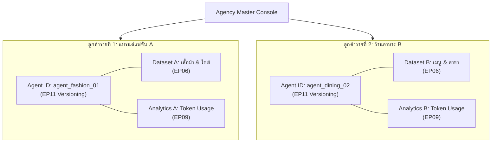

# 05 — Use Cases งานเอเจนซี่และฟรีแลนซ์ (Agency & Freelancer Workflows)

รวมแนวคิดการนำ LangMind API มาสร้างระบบบริหารจัดการลูกค้าหลายแบรนด์ การรับบรีฟอัตโนมัติ และการเปิดบริการสร้างบอตเป็นสินค้าขายต่อ (AI-as-a-Service)

---

## 1. ระบบบริหารจัดการ AI ประจำลูกค้าหลายแบรนด์ (Multi-Brand Agency Dashboard)

### โจทย์และปัญหา
- เอเจนซี่ที่รับดูแลการตลาดหรือตอบแชทให้ลูกค้า 10–20 แบรนด์ หากต้องสร้างระบบเซิร์ฟเวอร์หรือโมเดลแยกกันทั้งหมด จะมีค่าดูแลรักษาสูงมากและสับสน
- ข้อมูลความลับของแต่ละแบรนด์ห้ามปนกันเด็ดขาด (Strict Data Isolation) และต้องสามารถวัดค่าใช้จ่าย Token แยกรายลูกค้าเพื่อออกใบแจ้งหนี้ได้ถูกต้อง

### สถาปัตยกรรมระดับ Agency ด้วย LangMind API

### ฟังก์ชันที่นำมาใช้
- **[EP11 Agents & Versioning API](../episodes/ep11-agents-versioning/README.md)**: สร้าง Agent แยกตัวตนรายแบรนด์ รองรับ Draft Mode ให้ลูกค้าทดสอบก่อน Publish จริง และ Rollback ได้ทันทีหากเกิดข้อผิดพลาด
- **[EP06 Knowledge API](../episodes/ep06-knowledge-rag/README.md)**: แยก Dataset ID ชัดเจน ไม่มีการรั่วไหลของข้อมูลข้ามลูกค้า
- **[EP09 Analytics API](../episodes/ep09-analytics-feedback/README.md)**: ดึงข้อมูลการใช้ Token รายวัน/รายเดือน ของแต่ละ Agent เพื่อคำนวณต้นทุนและออกบิลค่าบริการลูกค้า

---

## 2. บอตรับบรีฟลูกค้าใหม่อัตโนมัติ (Automated Client Onboarding & Briefing Bot)

### โจทย์และปัญหา
- ปัญหาคลาสสิกของเอเจนซี่: ลูกค้าส่งบรีฟงานสั้นๆ เช่น *"อยากได้เว็บสวยๆ ล้ำๆ"* หรือ *"อยากได้แคมเปญไวรัล"* พองานเสร็จ ลูกค้ากลับบอกว่าไม่ตรงใจ ต้องแก้งานซ้ำซาก เสียเวลาทั้งสองฝ่าย

### กลไกการทำงานด้วย LangMind API
- **ส่งลิงก์สัมภาษณ์บรีฟ (Web Chat หรือ LINE)**: เมื่อรับลูกค้าใหม่ เอเจนซี่ส่งลิงก์แชทที่สร้างผ่าน [Custom Chat (EP02)](../episodes/ep02-custom-chat/README.md)
- **สวมบท Account Executive (AE) มืออาชีพ**: บอตจะสัมภาษณ์ซักไซ้ข้อมูลสำคัญอย่างสุภาพ:
  - วัตถุประสงค์หลักของโปรเจกต์คืออะไร?
  - กลุ่มเป้าหมายอายุเท่าไหร่ ไลฟ์สไตล์แบบไหน?
  - โทนอารมณ์และตัวอย่างงานที่ชอบ / ที่ไม่ชอบ?
  - งบประมาณที่ตั้งไว้ และเดดไลน์ส่งงานไฟนอล?
- **สร้าง One-Page Creative Brief**: บอตนำบทสนทนาทั้งหมดมาสังเคราะห์เป็นเอกสารสรุปบรีฟหน้าเดียว (Creative Brief) ส่งเข้าอีเมลทีมออกแบบ/โปรแกรมเมอร์ทันทีผ่าน [Chat History & Export (EP08)](../episodes/ep08-chat-history/README.md)

---

## 3. บริการ White-Label AI Chatbot สำหรับ Agency (เปิดขายบริการบอตให้ลูกค้า)

### โมเดลธุรกิจ
- เอเจนซี่สามารถนำ LangMind API ไปทำเป็นบริการเสริม (Add-on Service) ให้กับลูกค้าที่จ้างทำเว็บไซต์หรือทำการตลาด:
  1. ค่าติดตั้งและจัดทำฐานข้อมูลความรู้เริ่มต้น (Setup & RAG Embedding Fee)
  2. ค่าดูแลรักษารายเดือน (Monthly Maintenance & Analytics Reporting)
  3. สรุปรายงานรายเดือนให้ลูกค้าเห็นว่า บอตช่วยตอบคำถามไปกี่พันครั้ง ช่วยประหยัดเวลาแอดมินคนจริงไปกี่ชั่วโมง
