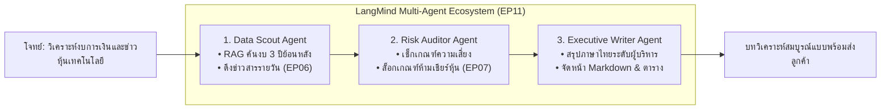
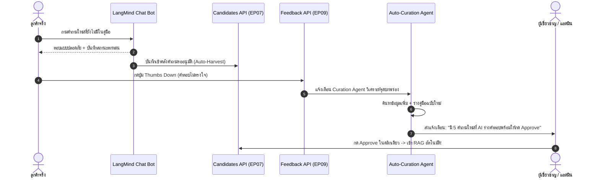
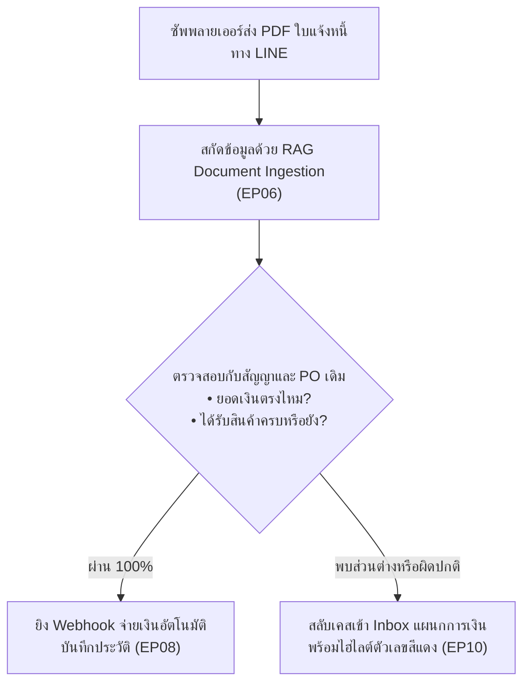

# 06 — นวัตกรรมแห่งอนาคตด้วย AI Agent (Next-Gen AI Agent Innovations)

คลังพิมพ์เขียวไอเดียระดับนวัตกรรม (Inspirational Blueprints) ออกแบบมาสำหรับการหยิบไปผลิตเป็นวิดีโอเพื่อจุดประกายแรงบันดาลใจ (Inspiring Creators & Developers) ให้เห็นถึงศักยภาพสูงสุดที่ไม่มีขีดจำกัดของ LangMind API ในการปฏิวัติการทำงานและสร้างสรรค์สิ่งใหม่

---

## 1. Multi-Agent Swarm: ทีมเอเจนต์ทำงานร่วมกันเป็นองค์กรเสมือน (Autonomous Virtual Team)

### 💡 จุดประกายแรงบันดาลใจ (The Wow-Factor Hook)
> *"ถ้าบริษัทของคุณมีทีมวิเคราะห์การลงทุน 3 คนทำงานตลอด 24 ชั่วโมง โดยไม่ต้องจ่ายเงินเดือนหลักแสน แต่ใช้ AI Agent 3 ตัวที่คุยงานและส่งต่อเอกสารให้กันเองใน 5 วินาที?"*

### ⚙️ สถาปัตยกรรมระบบเบื้องหลัง (LangMind Multi-Agent Architecture)

### 🎬 ไอเดียภาพในคลิปวิดีโอ (Visual Sparks)
- **Beat 1**: เปิดด้วยหน้าจอจำลองโปรแกรมส่งต่องาน มีกล่องข้อความของ Agent 3 ตัวกำลังพิมพ์สรุปงานให้กันเหมือนทีมงานคุยใน Slack/Discord
- **Beat 4–6**: เจาะลึกการส่งต่อ Payload จาก Agent 1 (ค้น RAG) → Agent 2 (กรองกฎเกณฑ์ผ่าน Simple Knowledge) → Agent 3 (เขียนสำนวนสละสลวย)
- **Beat 8**: ผู้บริหารเพียงแค่เปิดดูและเซ็นอนุมัติในคลิกเดียว

---

## 2. Self-Evolving Knowledge Loop: ระบบความรู้ที่ฉลาดขึ้นเองแบบวงรอบปิด (Self-Improving AI)

### 💡 จุดประกายแรงบันดาลใจ (The Wow-Factor Hook)
> *"หมดยุคที่ต้องคอยอัปเดตแชทบอตทีละข้อ... นี่คือระบบ AI ที่รู้ว่าตัวเองตอบคำถามไหนไม่ได้ แล้วแอบไปดึงคำถามจริงมารวมกลุ่ม พร้อมร่างคำตอบใหม่รอให้คุณกดอนุมัติในคลิกเดียว!"*

### ⚙️ กลไกการทำงานด้วย LangMind Closed-Loop

### 🎬 ไอเดียภาพในคลิปวิดีโอ (Visual Sparks)
- โชว์กราฟความแม่นยำของ AI ที่พุ่งสูงขึ้นเรื่อยๆ จากสัปดาห์ที่ 1 ถึงสัปดาห์ที่ 4 โดยที่มนุษย์แทบไม่ต้องพิมพ์คู่มือเองเลย

---

## 3. Ambient Voice & Physical AI: ช่างซ่อมโรงงานไร้สัมผัส (Hands-Free Industrial Voice Assistant)

### 💡 จุดประกายแรงบันดาลใจ (The Wow-Factor Hook)
> *"มือเปื้อนจาระบี กำลังปีนบันไดสูง 5 เมตร... จะเปิดอ่านคู่มือหนา 800 หน้าอย่างไร? แค่พูดคุยผ่านหูฟัง เสียง AI ภาษาไทยจะบอกคุณทีละสเต็ปว่าต้องขันน็อตตัวไหน"*

### ⚙️ สถาปัตยกรรมระบบผสานโลกกายภาพ
- **[EP04 Voice STT](file:///c:/Users/Admin/Desktop/work/gitlab_intern/LangMine-API-VDO/episodes/ep04-voice-api/README.md)**: ถอดความคำพูดภาษาไทยแม่นยำ แม้มีเสียงเครื่องจักรแทรกซ้อน (Noise Cancellation + High-accuracy STT)
- **[EP06 Knowledge RAG](file:///c:/Users/Admin/Desktop/work/gitlab_intern/LangMine-API-VDO/episodes/ep06-knowledge-rag/README.md)**: จัดเก็บแบบแปลนเครื่องจักร รหัส Error Codes และคู่มือการบำรุงรักษาเชิงป้องกัน (Preventive Maintenance)
- **[EP04 Voice TTS](file:///c:/Users/Admin/Desktop/work/gitlab_intern/LangMine-API-VDO/episodes/ep04-voice-api/README.md)**: พูดตอบกลับอย่างใจเย็น ชัดเจน และเว้นวรรคจังหวะให้ช่างทำงานตามได้ทัน

### 🎬 ไอเดียภาพในคลิปวิดีโอ (Visual Sparks)
- หน้าจอจำลองโรงงานอุตสาหกรรม มีเสียงแจ้งเตือน Alarm แดงกระพริบ ช่างพูดผ่านวิทยุสื่อสาร/หูฟัง AI สกัดรหัส Error แล้วบอกวิธีปลดล็อกวาล์วฉุกเฉินทันที

---

## 4. Interactive Simulation & Soft-Skills Gym: สนามซ้อมรับมือลูกค้าเหวี่ยง (AI Roleplay Simulator)

### 💡 จุดประกายแรงบันดาลใจ (The Wow-Factor Hook)
> *"อย่าส่งพนักงานใหม่ไปรับกระสุนจริงหน้างาน! ให้พวกเขาซ้อมรบกับ AI ลูกค้าสายเหวี่ยง ที่มีระดับอารมณ์ฉุนเฉียวสมจริง พร้อมระบบตัดเกรดความใจเย็นและทักษะการเจรจา"*

### ⚙️ กลไกการทำงานระดับ Simulator
1. **Dynamic Emotion Prompting**: เซ็ต [Agents API (EP11)](file:///c:/Users/Admin/Desktop/work/gitlab_intern/LangMine-API-VDO/episodes/ep11-agents-versioning/README.md) ให้สวมบทบาทลูกค้าโมโหจากการขนส่งช้า
2. **Real-time Voice Conversation**: พนักงานซ้อมพูดคุยด้วยเสียงจริงผ่าน [Voice API (EP04)](file:///c:/Users/Admin/Desktop/work/gitlab_intern/LangMine-API-VDO/episodes/ep04-voice-api/README.md)
3. **Automated Scorecard**: เมื่อจบการจำลอง [Analytics API (EP09)](file:///c:/Users/Admin/Desktop/work/gitlab_intern/LangMine-API-VDO/episodes/ep09-analytics-feedback/README.md) สร้างใบคะแนน:
   - Empathy Score (คะแนนความเข้าอกเข้าใจ): 8.5/10
   - Policy Compliance (ความถูกต้องตามระเบียบเคลมสินค้า): 10/10
   - Tone & Patience (ระดับความใจเย็นและน้ำเสียง): 9.0/10

### 🎬 ไอเดียภาพในคลิปวิดีโอ (Visual Sparks)
- หน้าจอจำลองหลอดวัดระดับความโกรธของลูกค้า (Anger Meter) ค่อยๆ ลดลงจากสีแดงกลายเป็นสีเขียวเมื่อพนักงานใช้คำพูดที่ถูกต้อง

---

## 5. Autonomous Compliance Radar: เรดาร์ตรวจจับความเสี่ยงกฎหมายและสัญญา (Enterprise Legal Radar)

### 💡 จุดประกายแรงบันดาลใจ (The Wow-Factor Hook)
> *"ประกาศราชกิจจานุเบกษาออกใหม่ตอนเช้า... บ่ายวันนั้น AI สแกนสัญญาคู่ค้า 1,200 ฉบับในคลัง แล้วกางให้ดูทันทีว่ามี 3 ฉบับที่เสี่ยงโดนค่าปรับ พร้อมร่างข้อแก้ไขให้เสร็จสรรพ"*

### ⚙️ การประยุกต์ใช้ RAG ระดับวิเคราะห์เชิงลึก
- **URL & PDF Ingestion**: ดูดข้อบังคับ กฎหมายแรงงาน กฎหมายคุ้มครองข้อมูลส่วนบุคคล (PDPA) หรือภาษีใหม่เข้าสู่คลังความรู้
- **Cross-Contract Auditing**: ใช้ Agent ตรวจเทียบเอกสารสัญญาเดิมกับกฎหมายใหม่
- **Traffic-Light Risk Matrix**: จัดเกรดสัญญาเป็น สีเขียว (ปลอดภัย), สีเหลือง (ควรปรับปรุง), สีแดง (ขัดกฎหมายทันที)

### 🎬 ไอเดียภาพในคลิปวิดีโอ (Visual Sparks)
- แผง Radar แดชบอร์ดสุดล้ำที่แสดงแผนที่ความเสี่ยงทางกฎหมายขององค์กร ทำให้ฝ่ายบริหารเห็นคุณค่าของ AI อย่างมหาศาล

---

## 6. Zero-Human Backoffice: ระบบตรวจรับและจ่ายเงินอัตโนมัติ (Autonomous PO & Invoice Reconciliation)

### 💡 จุดประกายแรงบันดาลใจ (The Wow-Factor Hook)
> *"บริษัทที่มีบิลเดือนละ 5,000 ใบ ไม่ต้องมีคนมานั่งตรวจตัวเลขทีละบรรทัดอีกต่อไป... ให้ Agent ตรวจยอดกับสัญญา ส่งคำสั่งจ่ายเงิน แล้วทักหาคนเฉพาะตอนที่ตัวเลขไม่ตรงกัน"*

### ⚙️ สถาปัตยกรรมระบบไร้คน (Zero-Human Flow)

### 🎬 ไอเดียภาพในคลิปวิดีโอ (Visual Sparks)
- หน้าจอแสดงขั้นตอนการตรวจสอบที่วิ่งผ่านเอกสารนับร้อยใบด้วยความเร็วแสง และหยุดเฉพาะจุดที่ผิดปกติเพื่อส่งต่อให้คนจริงตรวจ

---

## บทสรุปสำหรับการสร้างสรรค์วิดีโอ (Creative Takeaway)

> **"LangMind ไม่ใช่แค่เครื่องมือสร้างแชทบอต... แต่มันคือ Agent Operating System (OS) สำหรับสร้างสรรค์นวัตกรรมธุรกิจแห่งอนาคต"**
>
> เมื่อนำไอเดียเหล่านี้ไปถ่ายทอดเป็นวิดีโอ คนดูจะไม่เพียงแค่ได้เรียนรู้โค้ด API แต่จะเกิดแรงบันดาลใจอย่างแรงกล้าที่จะลุกขึ้นมาสร้าง Solution ของตนเองทันที!
