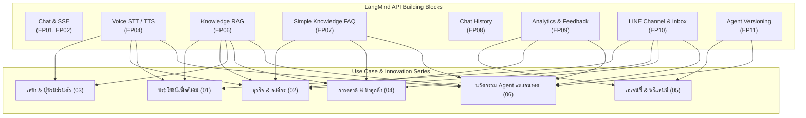

# Ideas & Use Cases Catalog — LangMind API Video Series

โฟลเดอร์รวบรวมไอเดีย คอนเซปต์ และ Use Cases สำหรับการนำ LangMind API ไปต่อยอดเป็นวิดีโอซีรีส์หรือโซลูชันจริง จัดทำขึ้นเมื่อวันที่ 9 พฤศจิกายน 2026

---

## โครงสร้างหมวดหมู่ไอเดีย (Idea Categories)

เอกสารในโฟลเดอร์นี้แบ่งออกเป็น 5 หมวดหลักตามกลุ่มเป้าหมายและการใช้งาน:

| หมวดหมู่ | เอกสาร | รายละเอียดและจุดเด่น |
|---|---|---|
| **1. ประโยชน์เพื่อสังคม** | [01-social-impact.md](01-social-impact.md) | สาธารณสุขชุมชน, การเข้าถึงของผู้พิการ/ผู้สูงอายุ, การศึกษาพื้นที่ห่างไกล, สุขภาพจิต, ภัยพิบัติ และเกษตรกรรม |
| **2. ธุรกิจและองค์กร** | [02-business-enterprise.md](02-business-enterprise.md) | อสังหาริมทรัพย์, คลินิกความงาม, โรงแรม/การท่องเที่ยว, ฝ่ายบุคคล (HR), ประกันภัย และร้านอาหาร |
| **3. เลขาและผู้ช่วยส่วนตัว** | [03-personal-assistant.md](03-personal-assistant.md) | เลขาเสียงตอนขับรถ (Voice Chief of Staff) และสมองที่สองค้นบันทึกย้อนหลัง (Second Brain) |
| **4. การตลาดและงานขาย** | [04-marketing-sales.md](04-marketing-sales.md) | นักเขียนคุมโทนแบรนด์ (Brand-Voice Copywriter), คัดกรองลีด 24 ชม. (Lead Qualifier) และสร้าง Proposal อัตโนมัติ |
| **5. งานเอเจนซี่และฟรีแลนซ์** | [05-agency-workflows.md](05-agency-workflows.md) | ระบบบริหาร Multi-Brand Agents แยกรายลูกค้า และบอตรับบรีฟลูกค้าใหม่อัตโนมัติ (Client Onboarding) |
| **6. นวัตกรรมแห่งอนาคตด้วย AI Agent** | [06-future-innovations.md](06-future-innovations.md) | **ชุดสร้างแรงบันดาลใจขั้นสุด**: Multi-Agent Swarm, Self-Evolving Loop, Ambient Voice โรงงาน, Roleplay Simulator, Legal Radar และ Zero-Human Backoffice |

---

## ความเชื่อมโยงกับฟีเจอร์หลักของ LangMind API

ทุก Use Case ในโฟลเดอร์นี้ ถูกออกแบบให้ดึงจุดแข็งของ API ที่เราทำใน **EP01–EP11** มาประกอบร่างกัน:

---

## พันธกิจการผลิตวิดีโอเพื่อ "สร้างแรงบันดาลใจ" (Inspiring Creators & Developers)

เป้าหมายสูงสุดของการหยิบไอเดียเหล่านี้ไปผลิตคลิป ไม่ใช่แค่สอนเรียก API ทีละเส้น แต่คือการ:
1. **เปิดโลกจินตนาการ (Expand Imagination)**: ทำให้คนดูร้อง *"เฮ้ย AI ทำแบบนี้ได้ด้วยเหรอ!"* และเห็นว่า LangMind ไม่ใช่แค่แชทบอต แต่เป็น **Agent Operating System (OS)**
2. **พิสูจน์ว่าเป็นไปได้จริง (Proof of Possibility)**: ทุกฉากทุกขั้นตอนในวิดีโอจะอ้างอิงจาก Endpoint และความสามารถจริงของระบบ LangMind API
3. **ส่งต่อพิมพ์เขียวสู่มือผู้สร้าง (Turn Ideas into Reality)**: เมื่อดูคลิปจบ ผู้พัฒนา นักศึกษา หรือผู้ประกอบการจะสามารถเปิดเอกสารและเริ่มต้นลงมือสร้าง Solution ของตนเองได้ทันที

---

## มาตรฐานการออกแบบเมื่อหยิบไอเดียไปผลิตเป็นคลิป (Production Ready)

เมื่อผู้ใช้เลือกไอเดียเพื่อนำไปสร้างเป็นตอนใหม่ (เช่น EP12 เป็นต้นไป) สามารถนำไปต่อยอดตามขั้นตอน Workflow ได้ทันที:
1. **โครงเรื่อง 9 Beats แบบ EP04**: ปูโจทย์คนดู (`b1`) → ผังภาพรวม (`b2`) → สิ่งที่ต้องเตรียม (`b3`) → จังหวะ User Journey 3 ขั้น (`b4, b5, b6`) → ข้อควรระวังและเทคนิคเสริม (`b7`) → สรุปคุณค่า (`b8`) → ป้ายผู้สนับสนุน (`b9`)
2. **ธีมภาพ**: Editorial Paper & Sage Ink, โค้ด Sweep ไฮไลต์, ภาพ Mockup อุปกรณ์จริง และตัวละคร Robot กลาง
3. **การแยกหน้าที่**: ระบุชัดเจนว่าส่วนไหนที่ LangMind จัดการให้ผ่าน API และส่วนไหนที่ Developer ต้องต่อยอดในระบบของตนเอง
